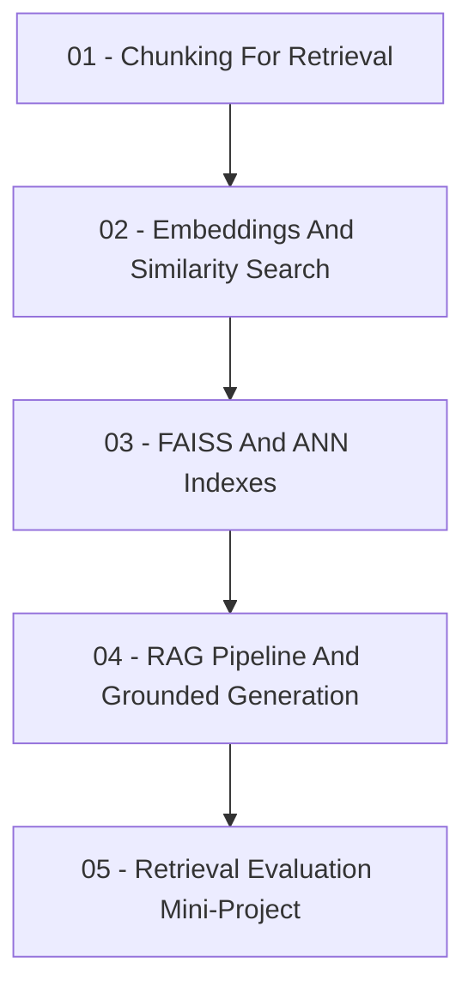

# Vector Databases, Similarity Search, and RAG Pipelines

This repository is a notebook-based learning path for building
[retrieval-augmented generation (RAG)](https://arxiv.org/abs/2005.11401)
systems from their retrieval foundation upward. It makes document splitting,
vector similarity, [FAISS](https://github.com/facebookresearch/faiss) indexing,
grounded generation, and retrieval evaluation inspectable before participants
move to managed vector-database deployments or orchestration frameworks.

The notebooks use a small shared course-handbook corpus and real FAISS indexes.
The generation notebook can call [Groq](https://console.groq.com/docs) or
[Mistral](https://docs.mistral.ai/) through the
[OpenAI Python library](https://github.com/openai/openai-python); without an
API key it uses an explicit deterministic dry-run response so the full path can
still be executed locally.

## Learning Path



- [01 - Chunking For Retrieval](01-chunking-for-retrieval.ipynb): Split source
  documents into retrieval units, compare overlap choices, and reason about
  evidence lost at chunk boundaries.
- [02 - Embeddings And Similarity Search](02-embeddings-and-similarity-search.ipynb):
  Build transparent normalized embeddings with
  [NumPy](https://numpy.org/doc/stable/), compute cosine similarity, and inspect
  top-k retrieval results.
- [03 - FAISS And ANN Indexes](03-faiss-and-ann-indexes.ipynb): Build exact and
  approximate [FAISS](https://faiss.ai/) indexes, map retrieved vector IDs back
  to metadata, and measure the accuracy-speed trade-off.
- [04 - RAG Pipeline And Grounded Generation](04-rag-pipeline-and-grounded-generation.ipynb):
  Reuse a [FAISS](https://faiss.ai/) index, connect retrieval to a guarded
  citation-aware provider prompt, and generate a grounded answer.
- [05 - Retrieval Evaluation Mini-Project](05-retrieval-evaluation-mini-project.ipynb):
  Evaluate retrievers with
  [recall@k and mean reciprocal rank (MRR)](https://www.pinecone.io/learn/offline-evaluation/)
  and write an evidence-based improvement decision.

## Repository Map

```text
mle-vector-databases-rag-pipelines/
|-- assets/                              # sourced raster visuals
|-- data/
|   `-- course_handbook.json             # shared retrieval corpus
|-- .env.example                         # optional generation provider config
|-- requirements.txt                     # runtime dependencies
|-- 01-chunking-for-retrieval.ipynb
|-- 02-embeddings-and-similarity-search.ipynb
|-- 03-faiss-and-ann-indexes.ipynb
|-- 04-rag-pipeline-and-grounded-generation.ipynb
`-- 05-retrieval-evaluation-mini-project.ipynb
```

## Environment

Please make sure you **use this repository as a template** and set up a new virtual environment. You can use the following commands:

### macOS

```bash
pyenv local 3.11.3
python -m venv .venv
source .venv/bin/activate
python -m pip install --upgrade pip
python -m pip install -r requirements.txt
cp .env.example .env
```

### Windows PowerShell

```powershell
pyenv local 3.11.3
python -m venv .venv
.venv\Scripts\Activate.ps1
python -m pip install --upgrade pip
python -m pip install -r requirements.txt
Copy-Item .env.example .env
```

### Windows Git Bash

```bash
pyenv local 3.11.3
python -m venv .venv
source .venv/Scripts/activate
python -m pip install --upgrade pip
python -m pip install -r requirements.txt
cp .env.example .env
```

## Generation Provider Setup

Notebooks 01-03 and the retrieval evaluation in notebook 05 run without an API
key. Notebook 04 also executes without a key in dry-run mode, but a real
generation call is necessary to observe how a model uses retrieved evidence.

### Groq Primary Provider

1. Create a key from [Groq API keys](https://console.groq.com/keys).
2. Add it to `.env` as `GROQ_API_KEY`.
3. Keep `LLM_PROVIDER=groq`.

Groq documents its OpenAI-compatible endpoint in
[OpenAI compatibility](https://console.groq.com/docs/openai).

### Mistral Alternative Provider

1. Create a key following the [Mistral API key documentation](https://docs.mistral.ai/admin/security-access/api-keys).
2. Add it to `.env` as `MISTRAL_API_KEY`.
3. Set `LLM_PROVIDER=mistral`.

Mistral provides generation guidance in its
[text generation documentation](https://docs.mistral.ai/capabilities/completion/).

## API And Data Notes

- Never commit `.env`, provider keys, or personal account details.
- Provider model names, free tiers, billing rules, and rate limits may change;
  check the provider console before running live experiments.
- `data/course_handbook.json` is a small fictional policy corpus shared by the
  notebooks. It exists to make retrieval mistakes inspectable and is not an
  external factual source.
- Notebook visuals are sourced raster images kept under `assets/`; every image
  is introduced and credited beside its use in a notebook.

## Learning Objectives

By the end of this repository, you should be able to:

- Implement a document chunking strategy and explain its effect on retrieval
  quality and grounding evidence.
- Build a vector index with FAISS and perform approximate nearest neighbor
  search.
- Assemble a complete RAG pipeline that embeds documents, stores and retrieves
  vectors, and generates a cited answer from retrieved evidence.
- Evaluate retrieval quality with recall@k and MRR, then diagnose failures.

## Professional Tooling Context

These notebooks keep the essential mechanics visible. Production systems often
substitute or extend individual layers:

- [Sentence Transformers](https://sbert.net/) and provider embedding APIs
  produce stronger dense text embeddings than the transparent local baseline.
- [FAISS](https://faiss.ai/) is a vector similarity library; managed databases
  such as [Qdrant](https://qdrant.tech/documentation/) or
  [Chroma](https://docs.trychroma.com/) add persistence, metadata filtering,
  operational APIs, and scaling choices.
- [LangChain retrieval](https://python.langchain.com/docs/concepts/retrieval/)
  and [LlamaIndex](https://docs.llamaindex.ai/) provide orchestration
  abstractions after the underlying retrieval decisions are understood.
- Evaluation libraries such as
  [Ragas](https://docs.ragas.io/en/stable/) and
  [TruLens](https://www.trulens.org/) extend retrieval checks with groundedness
  and answer-quality evaluation.

## Further Reading

- Lewis et al. (2020),
  [Retrieval-Augmented Generation for Knowledge-Intensive NLP Tasks](https://arxiv.org/abs/2005.11401).
- Johnson et al. (2017),
  [Billion-scale similarity search with GPUs](https://arxiv.org/abs/1702.08734),
  the FAISS paper.
- Malkov and Yashunin (2018),
  [Efficient and robust approximate nearest neighbor search using HNSW](https://arxiv.org/abs/1603.09320).
- [FAISS getting started wiki](https://github.com/facebookresearch/faiss/wiki/Getting-started).
